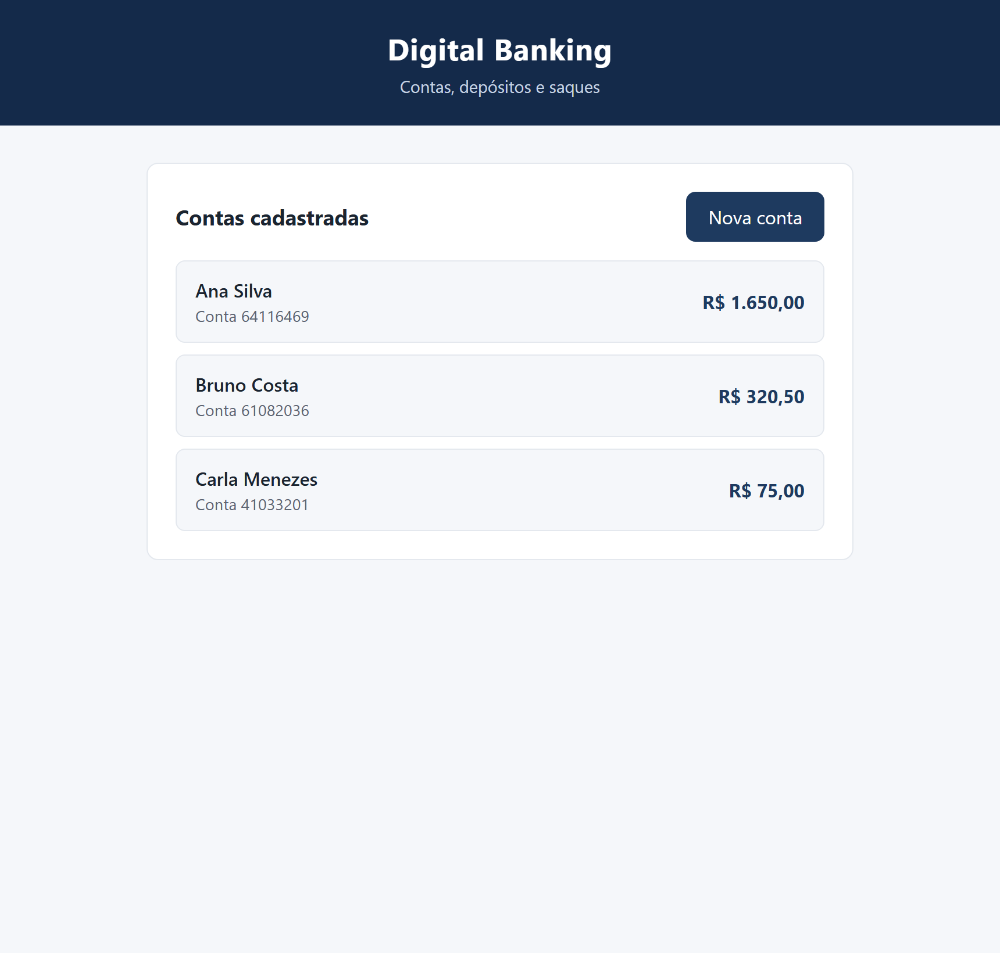
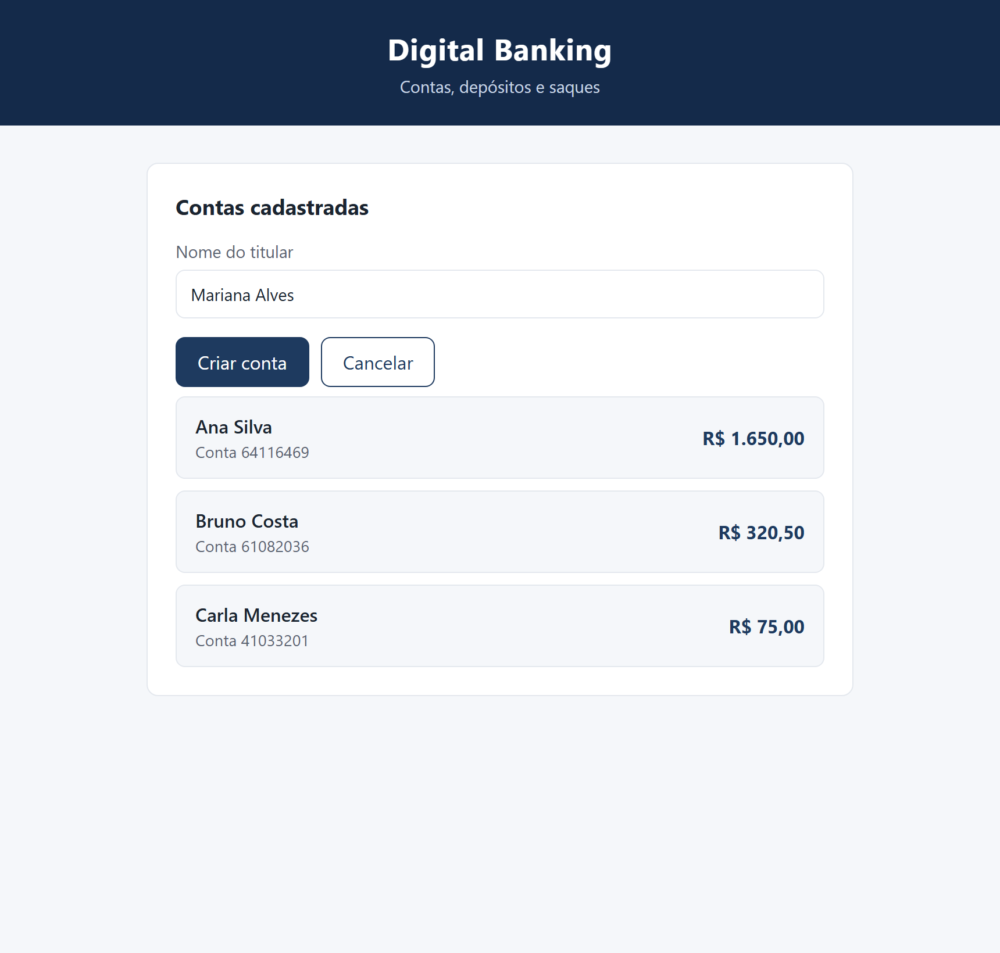
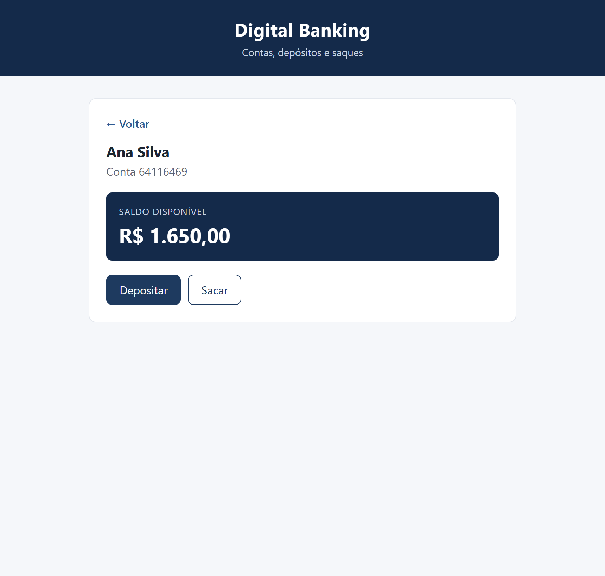

# Digital Banking API

A simple banking REST API for studying back-end development. It manages bank accounts and supports the core operations of creating an account, checking balances, depositing and withdrawing money — with the business rules and validations you would expect from a financial system.

The back end is built with **Java 25** and **Spring Boot 4**, persisted in **MySQL** through **Spring Data JPA**, and served through a **REST API**. A small **React + TypeScript** front end is included to demonstrate the full stack.


---

## Table of contents

- [Overview](#overview)
- [Tech stack](#tech-stack)
- [Features](#features)
- [Business rules](#business-rules)
- [API endpoints](#api-endpoints)
- [Error handling](#error-handling)
- [Project structure](#project-structure)
- [Getting started](#getting-started)
- [Running the tests](#running-the-tests)
- [Database scripts](#database-scripts)
- [Roadmap](#roadmap)
- [About](#about)

---

## Overview

The Digital Banking API exposes a small set of endpoints to manage bank accounts. Each account has an auto-generated unique number, a holder name and a balance that starts at `0.00`. Deposits and withdrawals update the balance, and balances can never become negative through a withdrawal.

Monetary values are handled with `BigDecimal` (never `double`), both in Java and in the database (`DECIMAL(19,2)`), to avoid floating-point rounding errors.

---

## Tech stack

**Back-End**
- Java 25
- Spring Boot 4 (`spring-boot-starter-webmvc`, `spring-boot-starter-data-jpa`, `spring-boot-starter-validation`)
- Spring Data JPA (Hibernate)
- Bean Validation (Jakarta Validation)
- Maven (with the Maven Wrapper included)

**Database**
- MySQL 8
- Plain SQL scripts for schema creation and migration (Hibernate `ddl-auto` is set to `none`)

**Front-End**
- React 19
- TypeScript
- Vite 8 (dev server with an `/api` proxy to the back end)
- Vitest (unit tests)

---

## Features

- Create a bank account with a holder name and an auto-generated account number.
- List all accounts (ordered by id).
- Look up a single account by id.
- Check the balance of an account.
- Deposit into an account.
- Withdraw from an account.
- Validate operation amounts and available balance.

---

## Business rules

- **Account number:** randomly generated with 8 digits (zero-padded) and guaranteed unique. The service retries up to 20 times on collision; if it cannot generate a unique number, it returns `409 Conflict`.
- **Holder name (`titular`):** required and limited to 120 characters. Values are trimmed before being stored.
- **Operation amount:** must not be null, must be greater than zero, must have at most two decimal places, and must not exceed `99999999999999999.99` (17 integer digits + 2 decimals). Invalid amounts return `400 Bad Request`.
- **Withdrawals:** cannot exceed the available balance; otherwise the API returns `409 Conflict`.
- **Operations on a nonexistent account:** return `404 Not Found`.
- **Initial balance:** every new account starts with `0.00`.

### Monetary operations

- All amounts use `BigDecimal`, normalized to scale 2 with `HALF_EVEN` rounding, and are stored as `DECIMAL(19,2)`.
- Deposits and withdrawals are executed inside a database transaction (`@Transactional`) and the account row is locked for writing (`PESSIMISTIC_WRITE`). This prevents two concurrent operations from reading the same balance and producing an inconsistent result.
- Balance updates are done with `add`/`subtract`, and a withdrawal is rejected before any change when the balance is insufficient.

### Validation layers

1. **Request validation (Bean Validation):** DTOs use `@NotBlank`, `@Size`, `@NotNull`, `@Positive` and `@Digits`. Failures return `400 Bad Request` with a list of field-level details.
2. **Domain validation (service layer):** the service re-checks the amount (not null, positive, scale, upper limit) as a safety net, so the rules hold even if the API is called from another entry point.

---

## API endpoints

Base URL: `http://localhost:8081`

| Method | Path                     | Purpose          | Success |
|--------|--------------------------|------------------|---------|
| POST   | `/contas`                | Create an account | `201 Created` (with `Location` header) |
| GET    | `/contas`                | List accounts     | `200 OK` |
| GET    | `/contas/{id}`           | Get an account    | `200 OK` |
| GET    | `/contas/{id}/saldo`     | Get the balance   | `200 OK` |
| POST   | `/contas/{id}/deposito`  | Deposit           | `200 OK` |
| POST   | `/contas/{id}/saque`     | Withdraw          | `200 OK` |

### Examples

Create an account:

```http
POST /contas
Content-Type: application/json

{ "titular": "Ana Silva" }
```

```json
{
  "id": 1,
  "numero": "00000042",
  "titular": "Ana Silva",
  "saldo": 0.00
}
```

Deposit and withdraw:

```http
POST /contas/1/deposito
Content-Type: application/json

{ "valor": 50.00 }
```

```http
POST /contas/1/saque
Content-Type: application/json

{ "valor": 20.00 }
```

Both return the updated account:

```json
{
  "id": 1,
  "numero": "00000042",
  "titular": "Ana Silva",
  "saldo": 30.00
}
```

---

## Error handling

Errors are handled centrally by `GlobalExceptionHandler` and returned in a consistent JSON body:

```json
{
  "timestamp": "2026-01-01T12:00:00Z",
  "status": 400,
  "error": "Bad Request",
  "message": "Dados de entrada inválidos.",
  "details": ["titular: O nome do titular é obrigatório."]
}
```

| Status | When it happens |
|--------|-----------------|
| `400 Bad Request` | Invalid or missing input (validation), invalid amount, or an unreadable/invalid request body |
| `404 Not Found` | The account id does not exist |
| `409 Conflict` | Withdrawal above the available balance, or it was not possible to generate a unique account number |
| `500 Internal Server Error` | Any unexpected error (logged on the server) |

> Note: user-facing error messages are currently written in Portuguese. This is intentional so the API messages match the front end, and it is listed in the roadmap as something to revisit.

---

## Project structure

```text
digital-banking-api/
├── src/main/java/com/digitalbanking/api/
│   ├── controller/     # REST controllers (ContaController)
│   ├── service/        # Business rules (ContaService)
│   ├── repository/     # Spring Data JPA repositories (ContaRepository)
│   ├── entity/         # JPA entities (Conta)
│   ├── dto/            # Request/response records (conta, operacao, comum)
│   ├── exception/      # Business exceptions (404, 409, 400)
│   └── handler/        # Global exception handler
├── src/main/resources/
│   ├── application.properties
│   └── db/             # schema.sql and the v1 -> v2 migration script
├── src/test/java/      # Controller and service tests
├── frontend/           # React + TypeScript + Vite application
└── docs/screenshots/   # UI screenshots used in this README
```

---

## Getting started

Instructions below target **Windows** with **VS Code / PowerShell**.

### Prerequisites

- JDK 25 (the project is configured for Java 25).
- MySQL 8 running on `localhost:3306`.
- Node.js 20 or newer (tested with Node 24) — only needed for the front end.
- Git, to clone the repository.

### 1. Clone the repository

```powershell
git clone https://github.com/evfernandes-dev/digital-banking-api.git
cd digital-banking-api
```

### 2. Create the database

The database is named `digital_banking` and is **not** created automatically by the application. Run the schema script for a fresh install:

```powershell
Get-Content src\main\resources\db\schema.sql | mysql -u root -p
```

> PowerShell does not support the `<` input redirection used in some tutorials. The command above pipes the file into the MySQL client instead. If you prefer, you can run it through `cmd`:
>
> ```powershell
> cmd /c "mysql -u root -p < src\main\resources\db\schema.sql"
> ```
>
> If the `mysql` command is not on your `PATH`, use the full path to the MySQL client executable.

If you already have a database from the earlier version (with the `clientes`/`transacoes` tables) and want to keep the data, run `src\main\resources\db\migracao-v1-para-v2.sql` instead of `schema.sql` — see [Database scripts](#database-scripts).

### 3. Configure environment variables

The database credentials are read from environment variables (defaults: user `root`, empty password):

```powershell
$env:DB_USERNAME = "root"
$env:DB_PASSWORD = "your_mysql_password"   # leave empty if you have no password
```

A `.env.example` file is provided for reference. Never commit real credentials.

### 4. Run the back end (Spring Boot)

In a terminal:

```powershell
.\mvnw.cmd spring-boot:run
```

The API starts on **http://localhost:8081**.

### 5. Run the front end (React)

In another terminal:

```powershell
cd frontend
npm install
npm run dev
```

The UI opens on **http://localhost:5173**. During development, Vite forwards requests under `/api/*` to `http://localhost:8081`, so no CORS configuration is needed on the back end.

### Screenshots

Real screenshots of the application running against a demo database.

**Home — account list**



**Create account**



**Banking operations — balance, deposit and withdrawal**



---

## Running the tests

**Back end (JUnit 5 + MockMvc):**

```powershell
.\mvnw.cmd test
```

`ContaControllerTest` covers the HTTP layer (status codes, response body and validation) with a mocked service, and `ContaServiceTest` covers the business rules with a mocked repository.

**Front end (Vitest):**

```powershell
cd frontend
npm test
```

Currently, the front-end tests cover the currency formatter (`formatters.test.ts`). The API client and the React components are not yet covered — see [Roadmap](#roadmap).

---

## Database scripts

The `src/main/resources/db/` folder contains two scripts, run manually:

- **`schema.sql`** — for a fresh install. Creates the `digital_banking` database and the `contas` table.
- **`migracao-v1-para-v2.sql`** — for a database created with the earlier version. The simplified version stopped using the `clientes` and `transacoes` tables and now stores the holder directly in `contas.titular`. This script copies each holder name from the old `clientes` relationship into `contas.titular` before dropping the old columns and tables, so existing data is preserved.

> **Back up first** when running the migration:
>
> ```powershell
> mysqldump -u root -p digital_banking > backup_digital_banking.sql
> ```

Because Hibernate runs with `spring.jpa.hibernate.ddl-auto=none`, the application never creates or alters the schema — all schema changes go through these scripts. Monetary columns are always `DECIMAL(19,2)`.

---

## Roadmap

Planned improvements (not implemented yet):

- Transfers between accounts.
- Transaction history.
- User authentication and authorization.
- Pagination and filtering for account listings.
- Integration tests against a real database (for example, Testcontainers).
- English (or locale-aware) API error messages.
- UI improvements and a demo deployment.

---

## About

Digital Banking API is a study project for practicing back-end development and database integration. It deliberately starts from a small, working base (accounts, deposits and withdrawals) and grows over time, keeping the code organized and easy to follow.

Licensed under the [MIT License](LICENSE).

**Author:** Emanuel Vitor Fernandes

- GitHub: [@evfernandes-dev](https://github.com/evfernandes-dev)
- LinkedIn: [Emanuel Vitor Fernandes](https://www.linkedin.com/in/emanuel-vitor-fernandes-6a3796421)
